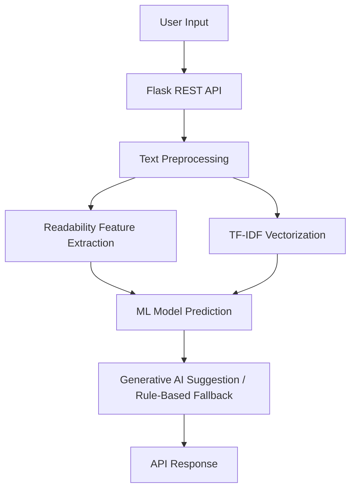

# AI Research Paper Readability Analyzer with Generative AI Suggestions for Improving Academic Accessibility

## Abstract
This project presents an AI-driven system designed to evaluate the readability of academic texts. It assigns a readability score, classifies the text difficulty (Easy, Moderate, Hard), and leverages Generative AI (Google Gemini) to provide actionable suggestions for improving accessibility. The system is designed to support the United Nations Sustainable Development Goal (SDG) 4: Quality Education, by helping educators and researchers make complex academic knowledge more accessible to a broader audience.

## Introduction
Academic papers are often laden with complex jargon and long, convoluted sentences, creating a barrier to entry for students, interdisciplinary researchers, and the general public. This project aims to break down these barriers by providing a tool that automatically analyzes text complexity and suggests specific improvements.

## Methodology
The system employs a hybrid approach combining traditional Natural Language Processing (NLP) readability metrics with Machine Learning and Generative AI:
1. **NLP Preprocessing**: Normalization, tokenization, and stopword removal using NLTK.
2. **Feature Extraction**: Computation of linguistic complexity metrics (Flesch Reading Ease, Gunning Fog, SMOG Index) using `textstat`.
3. **Machine Learning Classification**: A Logistic Regression model trained on TF-IDF features and readability statistics to classify text difficulty.
4. **Generative AI Suggestions**: Integration with Google Gemini to generate context-aware suggestions for simplification (with a rule-based fallback).

## System Architecture



## Implementation
The application is built using Python, Scikit-learn, NLTK, Flask, and Docker. It features a modular design with separate scripts for preprocessing, feature extraction, model training, and inference. The REST API handles JSON requests and returns structured predictions. 

## Results
The system successfully classifies academic text into varying levels of difficulty. It provides a numeric readability score normalized between 0-100 and delivers targeted suggestions to simplify the text. 

## Software Impact (SDG 4: Quality Education)
By automatically identifying complex research text and suggesting concrete improvements, this system directly supports inclusive and equitable quality education. It empowers authors to write more accessibly, ensuring that scientific knowledge is democratized and comprehensible to diverse learners worldwide.

## Usage Instructions

### Local Development

1. **Install Dependencies**:
   ```bash
   pip install -r requirements.txt
   ```

2. **Train the Model**:
   This will auto-generate a synthetic dataset and train the model.
   ```bash
   python src/train_model.py
   ```

3. **Run the Flask API**:
   ```bash
   # Optional: Set the Gemini API Key for AI suggestions
   # export GEMINI_API_KEY="your_api_key_here"
   
   python api/app.py
   ```

4. **Test with cURL**:
   ```bash
   curl -X POST http://localhost:5000/analyze \
   -H "Content-Type: application/json" \
   -d '{"text":"Deep neural network architectures have significantly improved performance in complex pattern recognition tasks."}'
   ```

### Docker Deployment

1. **Build the Image**:
   ```bash
   docker build -t readability-ai .
   ```

2. **Run the Container**:
   ```bash
   # Without Gemini API Key (Uses Rule-based fallback)
   docker run -p 5000:5000 readability-ai

   # With Gemini API Key
   docker run -p 5000:5000 -e GEMINI_API_KEY="your_api_key" readability-ai
   ```

### Running Tests
```bash
pytest tests/test_api.py
```
